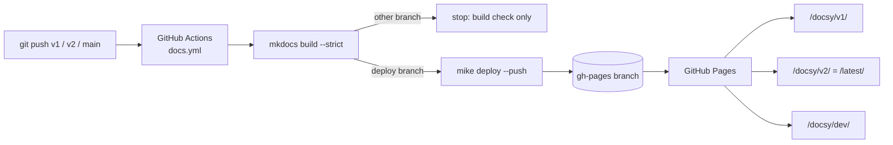

# docsy: versioned docs with MkDocs, mike and GitHub Actions

Documentation for **Tidewatch**, a fictional CLI that watches folders and runs tasks when
files change. The docs exist to show a real-world pattern: several versions of the same docs,
built from long-lived branches and served side by side under different URL paths.

**Live site:** https://nish8d.github.io/docsy/

## How versions map to branches and URLs

| Branch | Docs version | Alias | URL |
|--------|-------------|-------|-----|
| `v2`   | `v2`  | `latest` | [/docsy/v2/](https://nish8d.github.io/docsy/v2/), [/docsy/latest/](https://nish8d.github.io/docsy/latest/) |
| `v1`   | `v1`  | | [/docsy/v1/](https://nish8d.github.io/docsy/v1/) |
| `main` | `dev` | | [/docsy/dev/](https://nish8d.github.io/docsy/dev/) |

The site root (`/docsy/`) redirects to `latest`. Any other branch builds in CI but never
deploys.

## The pipeline



The interesting parts are in [`.github/workflows/docs.yml`](.github/workflows/docs.yml):

- **Build artifact on a branch.** `mike` commits each built version into its own folder on the
  `gh-pages` branch and maintains `versions.json`, which drives the version switcher in the
  header. Deploying `v1` only rewrites `v1/`; every other version is left untouched.
- **Branch-based deployment.** A single `case` statement maps the pushed branch to a docs
  version and an optional alias. The same workflow file lives on every branch.
- **Build and deploy are separate jobs.** Every branch runs `build`. Only `main`, `v1`
  and `v2` run `deploy`, which sits in the `gh-pages` concurrency group, so deploys from
  different branches queue instead of racing on the same branch. Build-only pushes stay
  outside that queue and can't bump a waiting deploy.
- **Fail fast.** `mkdocs build --strict` turns broken links and nav mistakes into a failed
  build before anything deploys.

## Run locally

```bash
python3 -m venv .venv
.venv/bin/pip install -r requirements.txt
.venv/bin/mkdocs serve          # this branch only, live reload
.venv/bin/mike serve            # every version from your local gh-pages branch
```

## Cut a new version

1. `git switch main && git switch -c v3`
2. In `docs.yml`, add `v3) version=v3; alias=latest ;;` to the mapping and drop
   `alias=latest` from `v2`. Each push runs the workflow file *from the pushed branch*, so
   make this change on `v2`, `v3` and `main`. Otherwise a later push to `v2` would take
   `latest` back.
3. Push `v3`. The workflow publishes `/docsy/v3/`, moves `latest` to it, and `v2` stays
   available at `/docsy/v2/`.
